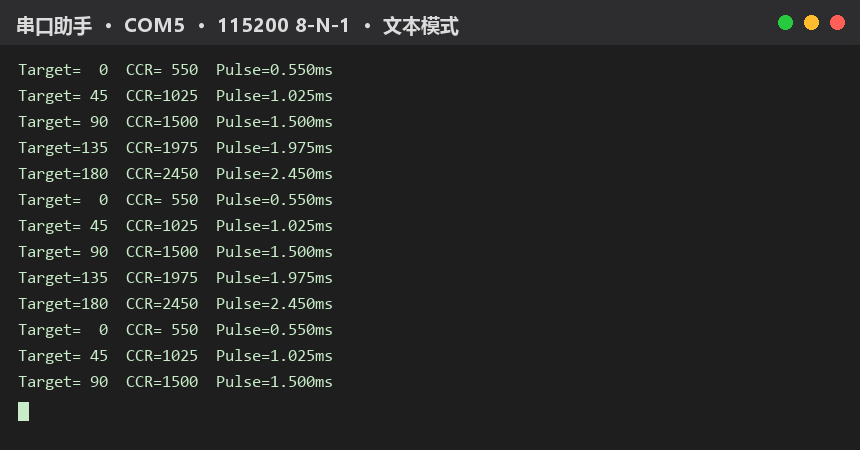

# RM-2027 电控培训 第四次作业

**王语清 / 20263001319 / 电控组**

> **仓库名说明**：作业要求仓库名统一为 `RM-2027-电控培训-作业-王语清`。GitHub 现在限制仓库名只能包含 ASCII 字母、数字和 `. - _`，中文会被强制替换成 `-`（实测提交中文名会被改成 `RM-2027------`），该限制已与组长确认。因此仓库名采用对应的拼音写法 **`RM-2027-diankong-hw4-wangyuqing`**，中文全名以此处为准。
>
> 仓库描述里写了完整中文名：`RM-2027 电控培训 第四次作业 | PWM 驱动 SG90 舵机 + OLED 显示 + 串口输出 | 王语清 20263001319`

STM32F103C8T6 最小系统板，用 TIM2 的 PWM 驱动 SG90 舵机按 0° → 45° → 90° → 135° → 180° 定角转动，每个角度停 1 秒；同时把「目标角度 / CCR / 脉宽」显示在 0.96 寸 OLED 上，并通过 USART1 打印到串口助手。

---

## 1. 硬件与接线

| 器件 | 引脚 | 说明 |
|---|---|---|
| SG90 舵机（橙线，信号） | **PA0** | TIM2_CH1，50 Hz PWM |
| SG90 舵机（红线，电源） | **独立 5 V / ≥1 A** | 不接板子的 5 V |
| SG90 舵机（棕线，地） | 独立电源 GND **＋ 板子 GND** | 必须共地 |
| OLED SCL | **PB8** | 软件 I²C |
| OLED SDA | **PB9** | 软件 I²C |
| OLED VCC / GND | 3.3 V / GND | |
| CH340 TXD | **PA10**（USART1_RX） | 交叉接 |
| CH340 RXD | **PA9**（USART1_TX） | 交叉接 |
| ST-Link | 3.3V / SWDIO(PA13) / SWCLK(PA14) / GND | 烧录 + 给板子供电 |

**为什么舵机要独立供电**：SG90 堵转电流约 700 mA，从最小系统板的 5 V 取电会把电压拉到复位阈值以下，表现为「一接舵机板子就复位」或「舵机抖个不停」。

**为什么必须共地**：PWM 信号是相对「地」的电压，板子和舵机电源不共地，信号就没有参考点，舵机要么不动、要么乱抖。

**为什么 OLED 用 PB8/PB9**：PB0/PB1 留给 ADC 采样通道；PB6/PB7 是 TIM4 的 CH1/CH2，也就是硬件 I²C1 最常用的引脚，一旦占用 OLED 会莫名不亮。

---

## 2. 时钟与定时器配置推导

### 2.1 时钟树

- HSE 外部晶振 **8 MHz**，PLL ×9 → **SYSCLK = 72 MHz**
- AHB 不分频 → HCLK = 72 MHz
- APB1 分频 /2 → PCLK1 = 36 MHz
- **但 APB1 上的定时器时钟 = 72 MHz**（APB1 分频系数不为 1 时，硬件会把定时器时钟自动 ×2）

> 这一步最容易出错：如果按 36 MHz 去算 PSC，出来的 PWM 频率正好差一倍，舵机完全不认。

### 2.2 把 1 个计数变成 1 µs

```
计数频率 = 定时器时钟 ÷ (PSC + 1)
72 MHz ÷ (71 + 1) = 1 MHz   →   1 个计数 = 1 µs
```

设 **PSC = 71** 之后，**CCR 的数值直接就是脉宽的微秒数**，后面算角度不用再乘任何系数。

### 2.3 得到 50 Hz

舵机要求 50 Hz，即周期 20 ms = 20000 µs：

```
(ARR + 1) × 1 µs = 20000 µs   →   ARR = 19999
```

设 **ARR = 19999**，验算：

```
72 000 000 ÷ (71 + 1) ÷ (19999 + 1) = 50 Hz  ✓
```

> 如果为了省事不分频、直接写 ARR = 20000，周期会变成 20000 × 13.9 ns ≈ 0.28 ms，也就是 3.6 kHz，舵机根本不认。

| 参数 | 值 |
|---|---|
| Prescaler (PSC) | **71** |
| Counter Mode | Up |
| Counter Period (ARR) | **19999** |
| auto-reload preload | Enable |
| Pulse (CCR) | 运行时由代码设定 |
| CH Polarity | High |

---

## 3. 角度换算与两端取值

```c
uint16_t AngleToCCR(float angle)
{
    if (angle < 0.0f)   angle = 0.0f;      // 限幅
    if (angle > 180.0f) angle = 180.0f;

    return (uint16_t)(SERVO_PULSE_MIN_US
                      + angle / 180.0f * (SERVO_PULSE_MAX_US - SERVO_PULSE_MIN_US));
}
```

其中 `SERVO_PULSE_MIN_US = 550`、`SERVO_PULSE_MAX_US = 2450`。

| 角度 | 计算 | CCR (µs) | 脉宽 |
|---|---|---|---|
| 0° | 550 + 0 | 550 | 0.550 ms |
| 45° | 550 + 45/180×1900 = 550+475 | 1025 | 1.025 ms |
| 90° | 550 + 950 | 1500 | 1.500 ms |
| 135° | 550 + 1425 | 1975 | 1.975 ms |
| 180° | 550 + 1900 | 2450 | 2.450 ms |

### 为什么两端不用 500 / 2500

SG90 的标称脉宽范围是 0.5 ms ~ 2.5 ms（对应 0° ~ 180°），但**真实舵机的机械行程比标称范围窄**。如果直接用 500 / 2500：

- 舵机会顶到内部的机械限位；
- 顶住以后电机仍在出力，就是**堵转**——电流飙升、发热、齿轮扫齿，长时间甚至烧电机。

所以两端各留一点余量：**0° 用 550 µs、180° 用 2450 µs**。90° 代进去正好是 1500 µs，也就是标准中位脉宽，可以作为自检基准——**如果 90° 时舵机不是垂直的，说明你的舵机中位有偏差，需要调整 `Servo_SetAngle` 里的偏置**。

### 上电不顶限位

`main()` 里的顺序是：

```c
Servo_SetAngle(SERVO_SEQ[0]);              // 先算好 CCR
HAL_TIM_PWM_Start(&htim2, TIM_CHANNEL_1);  // 再开 PWM
```

如果反过来，PWM 一启动 CCR 还是默认值 0，输出没有脉冲，舵机会先往一头撞到底再被拉回来。**先设 CCR 再启动**，上电瞬间就停在 0°，不会顶限位。

---

## 4. 代码结构

```
diankong4/
├── diankong4.ioc                  CubeMX 工程（外设配置都在这）
├── CMakeLists.txt                 顶层构建脚本
├── CMakePresets.json
├── cmake/
│   ├── gcc-arm-none-eabi.cmake    交叉编译工具链
│   └── stm32cubemx/CMakeLists.txt CubeMX 自动生成的源文件列表（别手改）
├── Core/
│   ├── Inc/  main.h  OLED.h  OLED_Font.h  Servo.h  stm32f1xx_hal_conf.h ...
│   └── Src/  main.c  OLED.c  Servo.c  stm32f1xx_it.c  stm32f1xx_hal_msp.c ...
├── Drivers/                       CMSIS + STM32F1xx HAL
├── startup_stm32f103xb.s
├── STM32F103XX_FLASH.ld
└── docs/                          串口截图等
```

自己写的两个文件：

- **`Core/Src/Servo.c` / `Core/Inc/Servo.h`** —— 角度换算 + 设置 CCR
- **`Core/Src/OLED.c`** —— 0.96 寸 OLED 的软件 I²C 驱动（引脚已改到 PB8/PB9）

> `cmake/stm32cubemx/CMakeLists.txt` 每次 CubeMX 生成代码都会被覆盖，所以新增源文件写在**顶层** `CMakeLists.txt` 里。同理，代码要写在 `main.c` 的 `/* USER CODE BEGIN ... */` 与 `/* USER CODE END ... */` 之间，否则下次生成就被冲掉了。

---

## 5. 运行效果

### 串口输出（COM5，115200 8N1）

```
Target=  0  CCR= 550  Pulse=0.550ms
Target= 45  CCR=1025  Pulse=1.025ms
Target= 90  CCR=1500  Pulse=1.500ms
Target=135  CCR=1975  Pulse=1.975ms
Target=180  CCR=2450  Pulse=2.450ms
Target=  0  CCR= 550  Pulse=0.550ms
...
```



### 演示视频

见 `docs/演示视频.mp4`（15 秒，1280×720，源片 4K/60fps 压到 720p/30fps 便于入库）。

镜头顺序：

1. **舵机的独立 5V 供电**——DC 电源头插在面包板电源模块上，红色指示灯亮；舵机红线取自这个模块的 5V，`不经过最小系统板`。这是本作业的硬性要求，也是「一接舵机板子就复位」的唯一根治办法。
2. **舵机与 OLED 同画面**——镜头拉开后，手持 SG90 就放在面包板前，屏上三行 `Target / CCR / Pulse` 与舵机摆臂同时可见。
3. 序列走到 `90°` 附近时，OLED 显示 `Target: 090deg / CCR:1500 / Pulse:1.500ms`，与串口打印一致。

> 注意：舵机的棕色地线和电源模块负极是直接连在一起的，再用一根线把这块地和板子的 `GND` 连起来（单点接地），所以舵机那 700 mA 的堵转电流不会流过最小系统板。

### 编译占用

```
RAM:    2152 B / 20 KB   (10.5%)
FLASH: 18324 B / 64 KB   (28.0%)
```

---

## 6. 踩过的坑

1. **资料包里的 OLED 驱动还是上一版**，引脚是 PB0(SDA)/PB1(SCL)，需要自己改到 PB8/PB9，一共三行：两个 `GPIO_PIN_x` 宏 + `GPIO_InitStructure.Pin`。
2. **TIM2 的时钟是 72 MHz 不是 36 MHz**。APB1 总线虽然是 36 MHz，但挂在 APB1 上的定时器时钟被硬件自动 ×2。按 36 MHz 算 PSC，PWM 会变成 100 Hz，舵机不认。
3. **`Prescaler` / `Counter Period` 忘了填**。在 CubeMX 里只把 PA0 设成 TIM2_CH1 是不够的——那只是「借出引脚」，还要把 `Clock Source` 设成 `Internal Clock`、`Channel1` 设成 `PWM Generation CH1`，然后才会出现 `Parameter Settings` 标签页，PSC/ARR 在那里填。
4. **printf 重定向要用 `_write`**。GCC/newlib 是 `int _write(int fd, char *ptr, int len)`；Keil MDK 才是 `fputc` / `__io_putchar`，抄错环境会链接报错。
5. **`%f` 会让程序体积暴涨十几 KB**。脉宽拆成 `ccr/1000` 和 `ccr%1000` 打印，既小又稳。
6. **舵机电源不要走面包板**。面包板簧片的接触电阻有几十到几百毫欧，700 mA 的堵转电流下压降能到 0.2~0.5 V，直接导致抖动或复位。舵机的红黑线直接飞线到电源，不要经过面包板。
